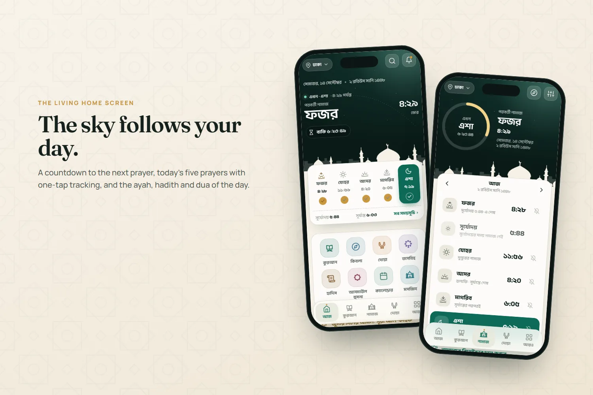
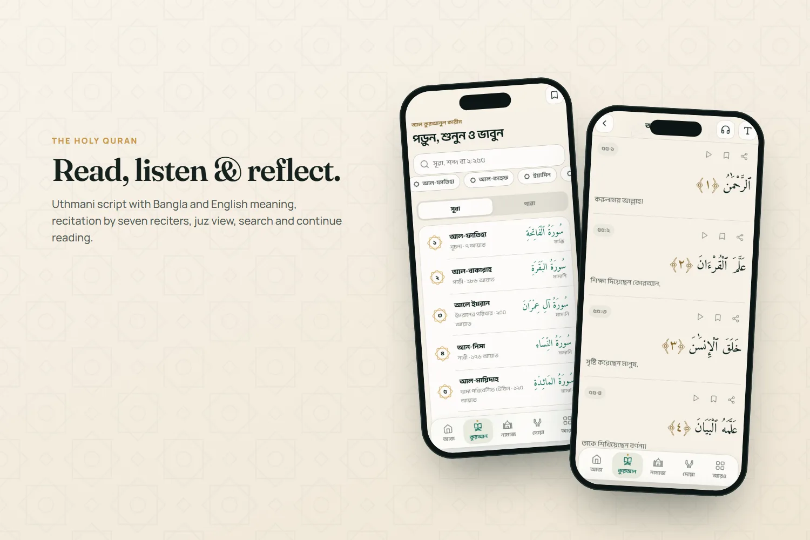
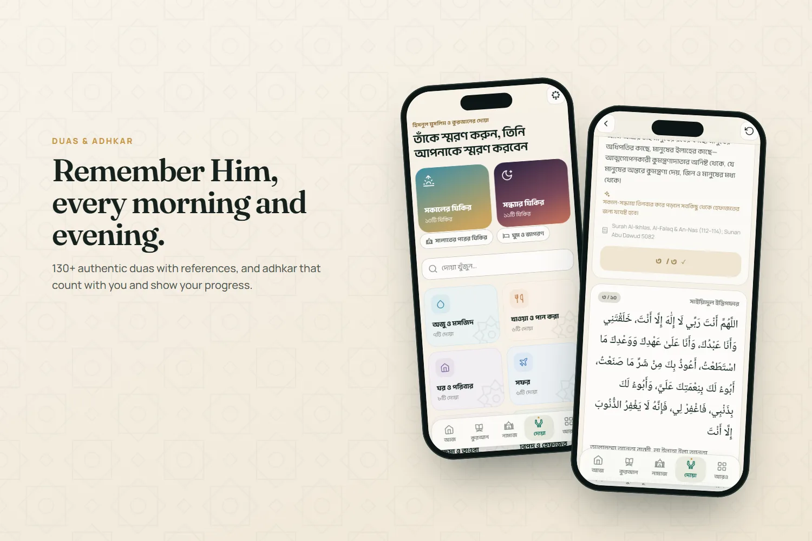
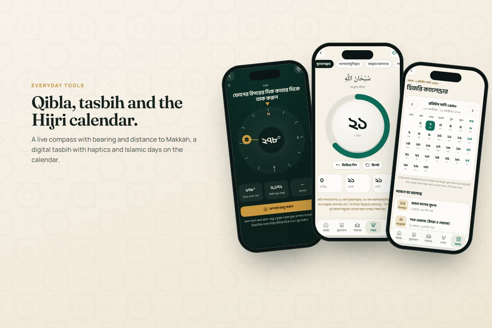
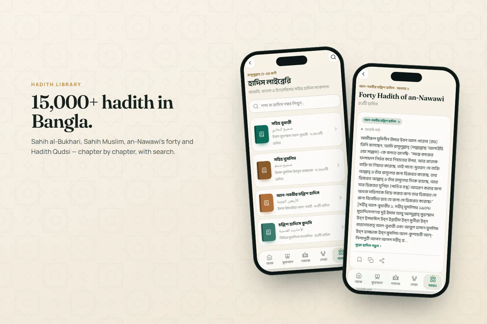
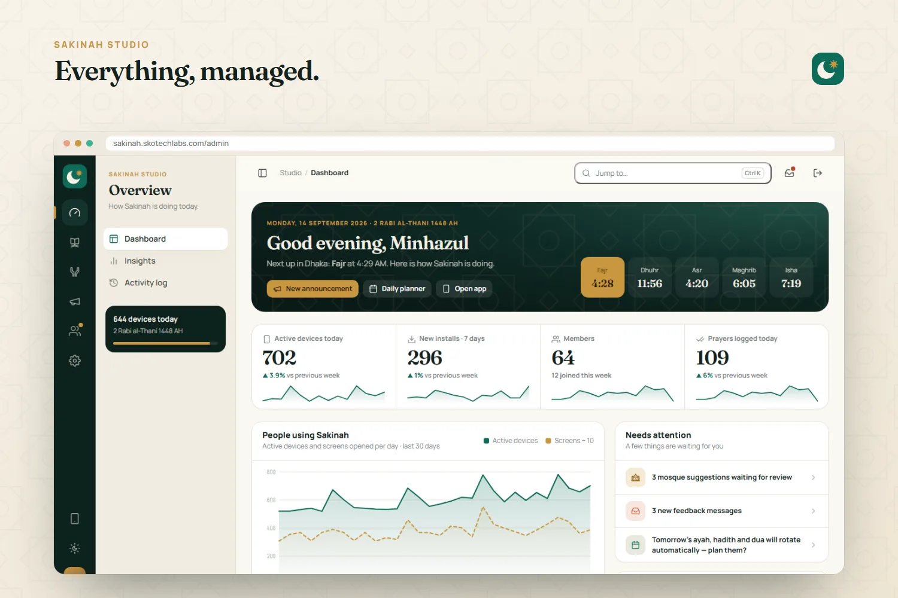
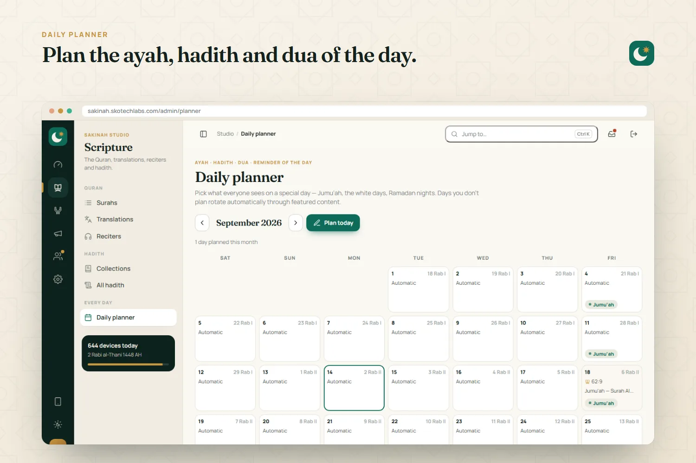
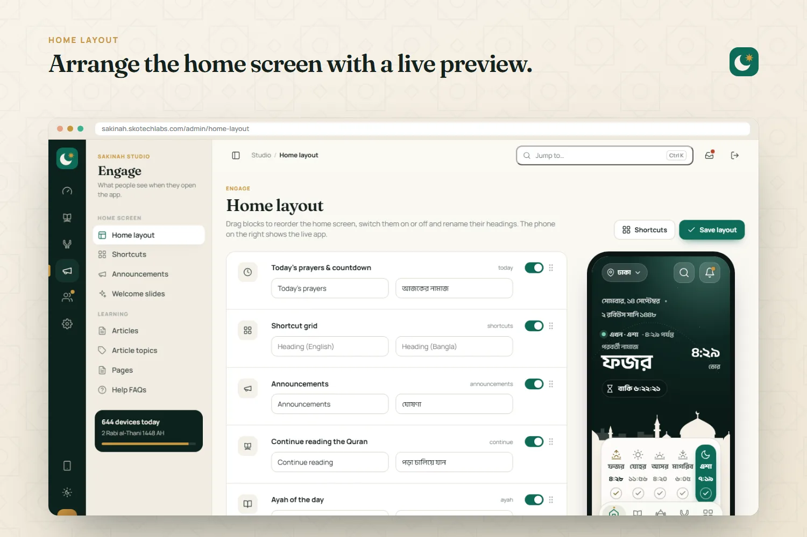
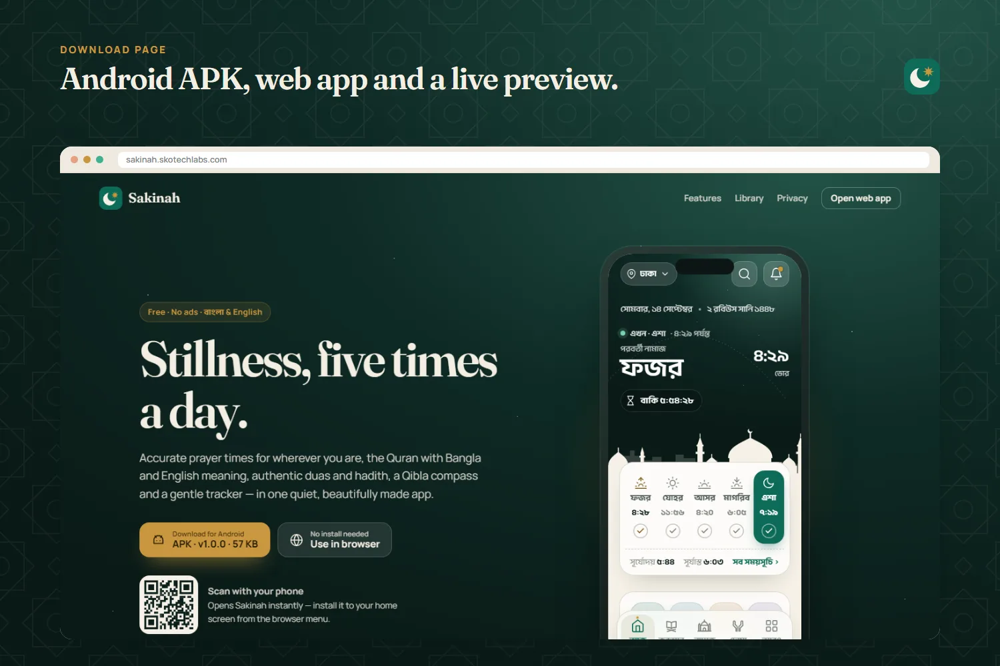

<h3>Ad-free Islamic companion app: prayer times, Quran, hadith, duas and qibla</h3>

A calm, ad-free Islamic companion app for Android and the web: accurate prayer times anywhere, the Quran with Bangla and English meaning and recitation, Sahih al-Bukhari and Muslim in Bangla, duas with adhkar counters, Qibla compass, tasbih, Hijri calendar and a prayer tracker — all managed from an admin studio.

   

<a href="https://sakinah.skotechlabs.com"><b>Live Demo</b></a> &nbsp;·&nbsp; <a href="https://skotechlabs.com/projects/sakinah-islamic-companion-app"><b>Case Study</b></a> &nbsp;·&nbsp; <a href="https://skotechlabs.com/contact"><b>Request a Demo</b></a> &nbsp;·&nbsp; <a href="https://github.com/skotechlabs"><b>All Products</b></a>

---

## Overview

Sakinah is a Bangla-first Islamic companion app built to feel quiet and beautiful. Its home screen paints the sky for the current prayer time — dawn at Fajr, bright teal at noon, amber at Asr, dusk at Maghrib and a starry night at Isha — above a mosque skyline, with a live countdown to the next prayer and one-tap prayer tracking.

Inside are the complete Quran (Uthmani script, Bangla and English meaning, verse-by-verse recitation by seven reciters, bookmarks and continue-reading), more than 15,000 hadith from Sahih al-Bukhari, Sahih Muslim and an-Nawawi's forty with Bangla text, 130+ authentic duas with morning and evening adhkar counters, the 99 Names of Allah, a Qibla compass, digital tasbih, a Hijri calendar with Islamic days, Ramadan sehri and iftar times, a zakat calculator, nearby mosques and short learning articles. It works as an installable web app and as an Android app that rings prayer reminders even when closed.

Everything is managed from Sakinah Studio: prayer calculation defaults, the Hijri date adjustment, the home screen layout and shortcuts, the daily ayah/hadith/dua planner, announcements, translations and hadith imports, duas, articles, mosques and member suggestions, feedback, Android releases, staff roles and anonymous usage insights.

<table>
<tr>
<td width="50%" valign="top">

### The Challenge

Most Islamic apps are either cluttered with ads or thin on trustworthy content, and few are designed for Bangla readers. Prayer times must match local mosques in Bangladesh and abroad, the Quran and hadith need reliable sources and careful Arabic typography, and the team running the app needs to adjust calculation settings, plan daily content and publish announcements without a developer — while respecting people's privacy.

</td>
<td width="50%" valign="top">

### Our Solution

We wrote a self-contained astronomical prayer-time engine verified against international references, paired with Umm al-Qura Hijri dates and an adjustable offset for local moon sighting. The Quran and hadith are imported from established open datasets (Tanzil, AlQuran Cloud, hadith-api) and set in Quranic and Naskh typefaces. The app is server-rendered for speed on modest phones, works offline as a PWA and ships as an Android app with native prayer alarms. Every screen, headline, shortcut, daily pick and setting is managed in Sakinah Studio, and usage is measured with anonymous daily counters instead of personal tracking.

</td>
</tr>
</table>

## Key Features

- Accurate prayer times for any location: 12 calculation methods, Hanafi/Shafi‘i Asr, high-latitude rules and minute adjustments
- A living home screen whose sky follows the prayer times, with a next-prayer countdown and one-tap prayer tracking
- The Holy Quran: Uthmani script, Bangla & English meaning, juz view, search by word or 2:255, recitation, bookmarks and continue reading
- Hadith library: Sahih al-Bukhari, Sahih Muslim, an-Nawawi's forty and Hadith Qudsi with Arabic, Bangla and English
- 130+ authentic duas with references, morning, evening and after-prayer adhkar with counters and progress
- Qibla compass with bearing and distance to Makkah, digital tasbih, 99 Names of Allah and a Hijri calendar with Islamic days
- Ramadan sehri & iftar timetable, zakat calculator with live nisab, nearby mosques with directions and learning articles
- Bangla and English throughout, light & dark themes, offline-ready installable web app and an Android app with prayer alarms
- Optional accounts that sync bookmarks, tracker and settings; guests keep everything on their device
- Sakinah Studio admin: home layout, shortcuts, daily planner, announcements, content, translations import, mosques, feedback, releases, roles and insights

## Business Impact

- Prayer times within a minute of international references for Dhaka, London, Makkah and New York
- The full Quran with two translations and 15,000+ hadith available in Bangla
- A home screen, daily content and announcements the team changes in minutes
- Works for guests without sign-up; members keep their tracker and bookmarks across devices
- An installable app experience on Android and the web from one codebase

## Screenshots

<table>
<tr>
<td width="50%" valign="top"> Home screen with the living sky, next-prayer countdown and prayer tracker</td>
<td width="50%" valign="top"> Quran reader with Bangla meaning, recitation and reading settings</td>
</tr>
<tr>
<td width="50%" valign="top"> Duas library and morning adhkar with counters</td>
<td width="50%" valign="top"> Qibla compass, digital tasbih and Hijri calendar</td>
</tr>
<tr>
<td width="50%" valign="top"> Hadith library: Sahih al-Bukhari and Sahih Muslim in Bangla</td>
<td width="50%" valign="top"> Sakinah Studio dashboard with usage, featured content and Islamic days</td>
</tr>
<tr>
<td width="50%" valign="top"> Daily planner for the ayah, hadith and dua of the day</td>
<td width="50%" valign="top"> Home layout builder with live phone preview</td>
</tr>
<tr>
<td width="50%" valign="top"> Download page with Android APK, web app and live preview</td>
<td width="50%"></td>
</tr>
</table>

> See it running: **[sakinah.skotechlabs.com](https://sakinah.skotechlabs.com)**

## Technology Stack

## Source Code & Licensing

This repository is the public showcase for **Sakinah**. The production source code is proprietary and is maintained privately by SKO TechLabs.

Interested in this product for your business? We offer:

- **Ready-to-launch deployment** of Sakinah under your own brand and domain
- **Customisation** of features, workflows, languages and integrations to fit how you work
- **Custom development** of a new product built on the same foundations
- **Ongoing support**, hosting, maintenance and feature roll-outs after launch

## Get in Touch

---

© 2026 <a href="https://skotechlabs.com">SKO TechLabs</a> · Dhaka, Bangladesh · Building intelligent digital solutions

